# broadside

A small deterministic Rust MCP server that builds, verifies, and
deploys [qompass.ai](https://qompass.ai) — and publishes the estate's
Agent Card JWKS at `/.well-known/jwks.json` from a signed key record.
A broadside is both the printed sheet this server publishes and the
volley its evidence packets deliver.

Every build, verify, deploy, and live check appends to an
append-only receipt log (`broadside.receipt` v1); vongola consumes
that log, so the site pipeline is an observed system — vongola stays
read-only, inside its charter. Deploy ships exactly one dist hash and
only behind a passing verify receipt for that identical hash, a
per-call confirmation, and a live read-back. The design also carries
a honeypot layer: signed canary manifests, injection quarantine in
the fetch pipeline, and hash-chained evidence packets — and no
hack-back, ever.

## Progress

<!-- tracker:start -->

**25% — 7 of 28 gates closed — updated 2026-10-21.**
Full record: [CHECKLIST.md](CHECKLIST.md) — every item traces to a stage gate in the program documents; the bar moves only on gated evidence.
<!-- tracker:end -->

Progress here is tracked from ideation to the finished 1.0 and
beyond: each checklist item is a stage gate from the program
documents, and it closes only on verified evidence.

## License

Apache-2.0 — see [LICENSE](LICENSE).
